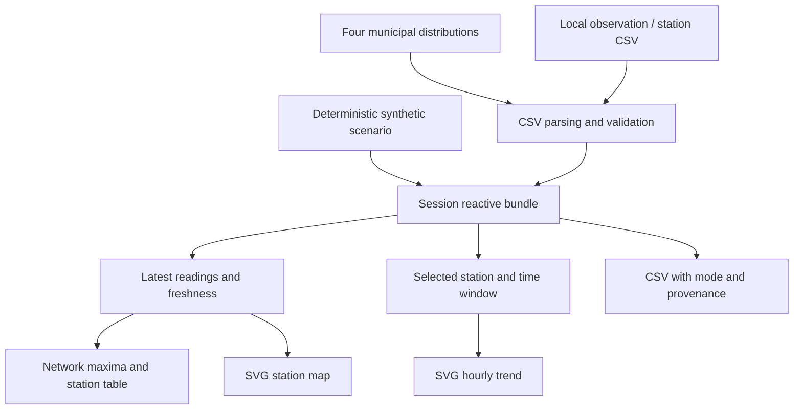

# Architecture

## Components

| File | Responsibility |
|---|---|
| `app.R` | Shiny layout, reactive state, refresh/import handlers and CSV export |
| `R/data.R` | Indicator definitions, demo generation, CSV adapters, validation and public source registry |
| `R/views.R` | Shared HTML components and SVG map/trend rendering |
| `R/content.R` | Dated newspaper summaries and official reference links |
| `www/style.css` | Responsive visual design and focus/reduced-motion treatment |
| `www/app.js` | Delegated click/keyboard bridge from SVG points to Shiny |
| `preview.R` | Generates a standalone offline preview without Shiny |
| `tests/test-data.R` | Deterministic data semantics, rendering and syntax checks |

## Data flow

Each Shiny session starts with a new synthetic bundle. A successful refresh replaces it with observations obtained from the municipal feeds. Failure of every observation source preserves the previous bundle and displays an error. A partially successful refresh accepts the available real network and records source failures. No missing real readings are filled from the demo.

Station metadata is keyed by both `network` and `station`. A missing official inventory disables plotting for that network instead of borrowing demo coordinates. Tables and time-series inspection can remain available without a map.

## Reactivity and rendering

The selected indicator determines the network, station choices, unit and default exploratory reference. The selected station and hour window filter the trend. Map interaction writes `map_station` through `Shiny.setInputValue`; the server checks the station belongs to the current selection before updating the selector.

Readings age against the current time, reevaluated every minute. Demo mode instead uses the end of its fixed synthetic scenario so the example remains reproducible. The minute timer does not download data. Refresh is manual and synchronous; four requests can temporarily occupy that session while they complete or time out.

The SVG map is a schematic geographical plot with coordinate axes, not a tiled basemap. It avoids map-service credentials and offline tile failures. The trend renderer separates lines at missing hourly intervals. HTML escaping is applied to text inserted into SVG attributes.

## Extension points

- Change `sources` and `parse_observations()` when a provider migrates its schema.
- Add indicator metadata to `metrics`, retaining the correct network, code and units.
- Add geography only after obtaining verified station metadata for that network.
- Update `R/content.R` and `RESEARCH.md` together when revising news evidence.
- Add a cache or background downloader only with explicit freshness and provenance semantics; neither exists today.

The shared view functions power both Shiny and the static preview. The preview's surrounding page is separately assembled; it is not a recording of a running Shiny session.
